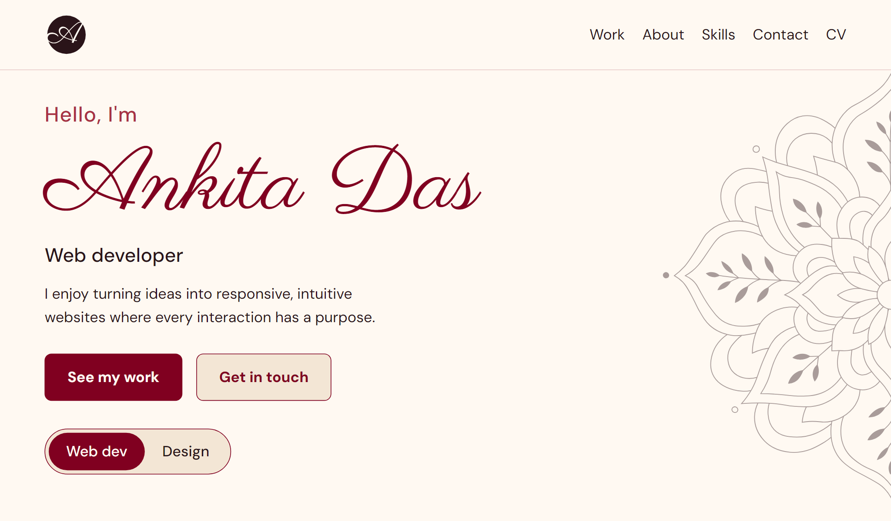
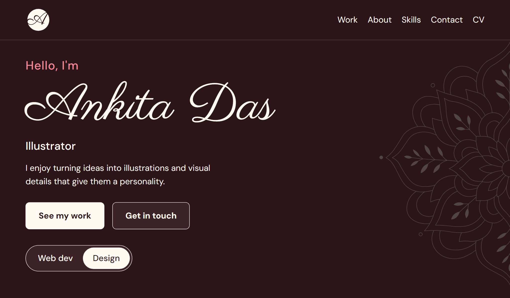

# Ankita Das | Portfolio

My personal portfolio, with two themes: a **Web dev** view for the websites I've built and a **Design** view for my illustrations and patterns.

**Live site:** https://ank-8818.github.io/ankita-das/

## What it does
- Switches between a light Web dev theme and a dark Design theme with one toggle
- Shows my web projects as cards with live links and code
- Opens each illustration or pattern in a modal with a short note on how I made it
- Includes skills, a "currently learning" list, and a working contact form
- Responsive on mobile and desktop

## The interesting parts
- The two-theme system: one page, two colour palettes and two sets of content
- CSS animations (mandala, button hovers)
- Contact form handled by a form service, with a hidden field to filter spam
- All illustrations, patterns and logos on the site are my own

## Built with
HTML, CSS, JavaScript (no frameworks). Fonts: Parisienne, Playfair Display and DM Sans. Hosted on GitHub Pages.

## Run it locally
Clone the repo and open `index.html` in a browser.

## Artwork
All artwork on this site is my own. Please don't reuse it without asking.

## What I'd improve
- Add a "Shop the patterns" button in the Design view
- Run an accessibility pass (contrast and alt text)
- Add Thought Dump as a full project once it's built